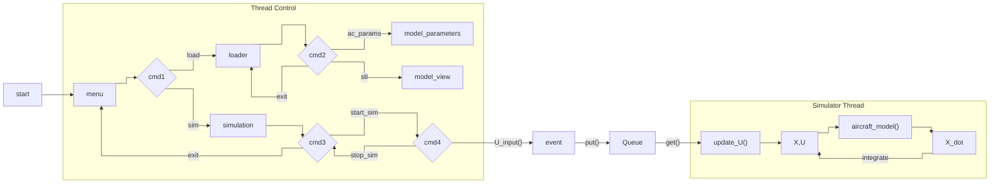

# NN

## Diagram

## Non Dimensions Forces

### $C_L$ Formulation

#### Wing

$$ C_L = a_w \alpha + C_{L0}\space ; \quad C_{L0}=a_w(twist+i_w - \alpha_0) $$

#### Tail (Horizontal)

$$ C_{L_t} = a_t \alpha_t $$

$$ \text{with:} \space \alpha_t = \alpha \left(1-\frac{\partial \epsilon}{\partial \alpha} \right) + i_t -\epsilon_0$$

### $C_Y$ Formulation
Since references define 
$C_Y = \frac{\partial C_Y}{\partial \beta}$, consequently the change respect side slip, this term have to consider the aportation fuselage-wing and tail; $C_Y$ as Side Force Result.

#### $C_Y$ Analyses respect a $\beta$
uan
##### Sidewash ($\sigma$)

$\sigma$ afect a local $\alpha_t$ under side slipe conditions. Anology with downwash, so have to considerate these effect's cause' the conditions of the wind going be pertubates.  

$$C_L = a \alpha + \frac{\partial C_L}{\partial \delta_r}\delta_r \quad; a = \frac{\partial C_L}{\partial \alpha}$$

$$\alpha = -\beta + \sigma$$

$$\frac{\partial \alpha}{\partial \beta} = \frac{\partial \sigma}{\partial \beta} -1$$

$\text{Analogy way with }C_{Y} \space \text{can be express how:} $ 

$$ C_Y = \frac{\partial C_Y}{\partial \beta} \beta + \frac{\partial C_Y}{\partial \delta_r} \delta_r $$

Therefore $\frac{\partial C_Y}{\partial \beta}$ have a contrubution for a lateral dynamic; moments generate by roll ($C_l$) and yaw ($C_n$).

### Lateral Moments $C_l, \space C_n$ Formulation

$$ \frac{\partial C_x}{\partial \beta} = \left(\frac{\partial C_x}{\partial \beta} \right)_{fuselage} + \left(\frac{\partial C_x}{\partial \beta} \right)_{wing} + \left(\frac{\partial C_x}{\partial \beta} \right)_{tail}$$

#### Roll

$\frac{\partial C_l}{\partial \beta}$ conteplate by wing, fuselage and tail.

##### Tail contribution

$$ \left(\frac{\partial C_l}{\partial \beta} \right)_{tail} = a_F \left(1-\frac{\partial \sigma}{\partial \beta}\right) \eta_v \frac{S_v}{S} \bar{Z} $$

$\text{Where:}$ $\bar{Z} = \frac{z_v}{b}$ $\text{Raymer defines} \left(1-\frac{\partial \sigma}{\partial \beta}\right) = \frac{\partial \beta_v}{\partial \beta}\eta_v$

$$\frac{\partial \beta_v}{\partial \beta}\eta_v = 
0.724+
\frac{3.06 \frac{S_{vs}'}{S}}{1+cos \Lambda_{c/4}} -0.4 \frac{Z_{wf}}{D_f}+0.009 AR_{w} $$

$\text{Where:}$

$$S_{vs}':\space \text{Vertical Area Surface extend to fuselage center line}$$

#### Wing - Fuselage contribution

Raymer explain in the literature the
dihedral angle and position of wing, have big a impact in the lateral stability.

##### Dihedral Angle $(\Gamma)$ 
$$
\left(\frac{\partial C_l}{\partial \beta}\right)_\Gamma = -\frac{a \Gamma}{4} \left[ \frac{2(1+2\lambda)}{3(1+\lambda)} \right]$$

##### Wing plus Fuselage
$$\left(\frac{\partial C_l}{\partial \beta} \right)_{wf} = -1.2 \frac{\sqrt{AR_w}  Z_{wf} (D_f + W_f)}{b^2}$$

#### Yaw

#### Tail Contribution
$$\left(\frac{\partial C_n}{\partial \beta}\right)_v =  \frac{\partial C_F}{\partial \beta_v}\cdot \left( \frac{\partial \beta_v}{\partial \beta} \right) \cdot \eta_v \cdot \left( \frac{S_v}{S_w} \right) \cdot \left( \bar{X}_{acv} - \bar{X}_{cg} \right)$$

#### Fuselage Contribution
_Considerations:_ In the references, Raymer propuse the next emperical equations to determine fuselage contribution.

$$\left(\frac{C_n}{\partial \beta}\right)_{fus} = - 1.3 \cdot \frac{\text{Volumen}_{\text{fus}}}{S_w \cdot b} \cdot \left( \frac{D_f}{W_f} \right)$$

#### Wing

The contribution of wing is due a sweep angle, another way, can be negligible
##### Swap Angle Effect
$$
\frac{\partial C_n}{\partial \beta}_w = C_L^2 \left\{ \frac{1}{4\pi AR_w} - \left[ \frac{\tan \Lambda}{\pi AR_w (AR_w + 4 \cos \Lambda)} \right] \left[ \cos \Lambda - \frac{AR_w}{2} - \frac{AR_w^2}{8 \cos \Lambda} + \frac{6(\overline{X}_{acw} - \overline{X}_{cg}) \sin \Lambda}{A} \right] \right\}
$$

### Control Surfaces.
For determine the effect by surfaces control in forces and moments terms normally use empircal methods. Therefore these source going assume a <valor que todavía no se jajajaja> percent of main surface.

## Phycis Model
For these model it's important understand that the aerodynamic forces, propulsive forces and body forces works in diferent frames. So use the Relative Derivate Theory ($C_{w/b}$) for get all system in the same frame.

The aerodynamic forces depend of speed of the body, so from **body speed** get aerodynamic angles ($\alpha, \space \beta$), determine the aerodynamic forces and uses $C_{w/b}$ for get these forces in the body frame, below with the **angle rates** (p,q,r), wich simulate the sensors of the aircraft so can be determine the position and future state of the system ($\dot x = x \cdot dt$) by any method of integration (euler explicit, RKT, etc).(***Note:*** *the angle rates no be a vector and works in body frames.*) 
